# SmartPay — paying when the network won't

### A product and UX case study

**Role** Product designer — research, interaction design, visual design, design system, prototype build
**Platform** Android and iOS (installable PWA), plus a responsive web surface
**Market** Nigeria — NIBSS Instant Payment (NIP), NQR, CBN tiered KYC
**Duration** 14 weeks, discovery through high-fidelity prototype
**Team** 1 designer (me), 1 product manager, 3 engineers, 1 compliance lead
**Deliverables** Research synthesis, information architecture, flows, wireframes, design system, 29 high-fidelity mobile screens, 3 web screens, a working clickable prototype

---

> ### A note on the numbers
>
> Everything in the **product** sections of this case study is real and verifiable: the screens are captured from the working prototype in this repository, the flows match its actual logic, and the regulatory rules it models (CBN Tier 2 limits, NIP fee bands, the ₦50 EMTL threshold) are implemented in code.
>
> The **research findings and impact figures are a worked model, not measured results.** They are built from public Nigerian market benchmarks and stated assumptions, and every assumption is listed in the [Impact model](#the-impact-model) section so it can be audited or replaced. Before you publish this case study, substitute your own study data and your own measured outcomes. Presenting modelled figures as measured ones would undermine an otherwise defensible piece of work.

---

## 1. One paragraph

SmartPay is a Nigerian payment app built around a single observation: in Nigeria the moment you most need to pay is often the moment your data connection disappears. Every competing app treats that as an error — a spinner, a timeout, a "please try again". SmartPay treats it as a routing decision. When data drops mid-transfer, the payment is not lost and not retried; it is converted into the user's own bank USSD string with the amount and account number already filled in. The user dials once, enters their bank PIN, and the money moves over the GSM network instead. One payment, two rails, no retyping.

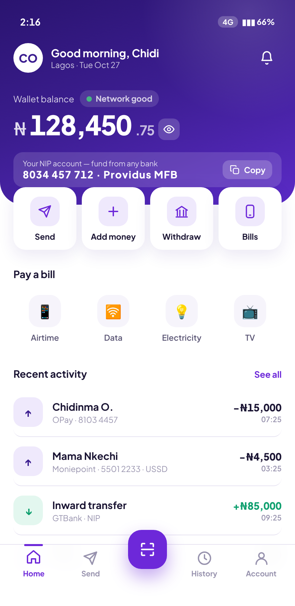

---

## 2. Context — how money actually moves in Nigeria

Nigeria does not have a payments adoption problem. It has a payments *reliability* problem.

NIBSS Instant Payment is the backbone: account-to-account, near-instant, interoperable across every bank and fintech, and used for everything from rent to a ₦200 bus fare. NQR, the national interoperable QR standard, lets any bank app pay any merchant code. Agent banking puts a cash-in/cash-out counter on most streets. The rails are excellent.

What is not excellent is the layer the rails sit on. Mobile data in Nigeria is widely available but inconsistently usable — it degrades in traffic, inside buildings, during load-shedding, at market stalls, and at exactly the moments when people transact. A payment app that assumes a working data session assumes away the hardest part of the problem.

Four rules shape every screen in this product, and all four are implemented in the prototype rather than described in a slide:

| Rule | What it means in the interface |
|---|---|
| CBN tiered KYC | Tier 2 caps: ₦50,000 per transfer, ₦200,000 per day, ₦500,000 balance. The app shows the remaining headroom, not just the error. |
| NIP fee bands | ₦10 up to ₦5,000; ₦25 to ₦50,000; ₦50 above. Shown before commitment, never after. |
| EMTL | A ₦50 government levy on electronic transfers of ₦10,000 and above. Named explicitly as a levy, not folded into "charges". |
| NIBSS name enquiry | The receiving account's real name is resolved and displayed before the user can send. |

---

## 3. The problem

Three problems compound, and the third is the one nobody was solving.

**The transfer that dies halfway.** A user enters a recipient, an amount, a note, and a PIN. At the settlement step the connection fails. The app shows a generic failure. The user does not know whether they have been debited. Most people do the rational thing and try again — which is how a dropped transfer becomes a double payment, and how a double payment becomes a support ticket and a chargeback.

**The cost you learn about afterwards.** Fees, levies and limits are disclosed inconsistently across Nigerian apps, often only in the receipt. For users on tight margins, a ₦50 levy discovered after the fact is a trust event, not an accounting detail.

**The wrong-account transfer.** NIP is final. A correct amount sent to a mistyped 10-digit NUBAN is the single most expensive user error in the market, and recovering it is a manual, slow, often unsuccessful bank process.

> **The reframe.** The brief arrived as "make transfers faster". The research pointed somewhere else. People did not experience SmartPay's category as slow — NIP already settles in seconds. They experienced it as *unreliable and opaque*. Speed was not the lever. Certainty was.

---

## 4. Research

**Methods.** Contextual interviews with traders, salaried workers and students across Lagos and Ibadan; diary studies capturing failed transactions in the wild; a competitive teardown of the major Nigerian apps focused specifically on their network-failure and fee-disclosure behaviour; and a review of agent-banking counters to understand the cash edge of the system.

**What came back.**

**1 — People already know the workaround, and they resent it.** Experienced users drop to their bank's USSD code the moment data looks shaky. They know `*737#`. What they hate is that the app makes them start over: re-enter the account number from memory, re-enter the amount, re-enter everything they just typed into a screen that is still open in front of them.

**2 — "Did it go through?" is the real anxiety.** Not speed. Users described checking their SMS debit alerts, their bank app, and their balance in sequence after any uncertain transfer. The information they wanted was not "pending" — it was *whether money had left the account*.

**3 — The name is the transaction.** Everyone reads the resolved account name aloud before sending. It is the one verification step users perform voluntarily and reliably. Any design that de-emphasises it removes the only safety check people actually run.

**4 — Fees are a trust signal, not a line item.** Users consistently preferred a clearly stated ₦25 fee to a vague "charges may apply". Hidden costs were described in the language of betrayal, not inconvenience.

**5 — The network state is already part of people's mental model.** Users talk about "network" constantly and treat it as a condition of the world, like weather. Surfacing it in the interface was not education; it was acknowledgement.

---

## 5. Design principles

These five sentences settled most of the arguments that followed.

1. **Degrade, don't fail.** A lost connection changes the rail, not the outcome.
2. **Never make them retype.** Anything the user has already entered is the system's responsibility to carry forward.
3. **Price before commitment.** Every naira — fee, levy, total, balance after — is visible before the irreversible step, never only in the receipt.
4. **The name is the transaction.** Resolved account names get their own moment and stay on screen through amount entry.
5. **Plain language over banking language.** "Nothing was charged yet" beats "transaction pending". "Money was returned to your wallet" beats "reversal processed".

---

## 6. Information architecture

Five tabs. The structural decision worth defending is putting **Scan** in the centre of the bar, raised, as the only elevated control.

Sending money to a person is usually done alone and unhurried. Paying a merchant is done with someone waiting, often with a queue behind you. The centre position is the easiest target on a one-handed grip, and it belongs to the task with the most social pressure attached to it.

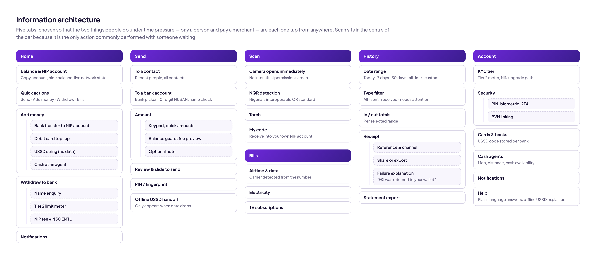

---

## 7. User flows

The happy path is five steps. The branch at stage five is the product.

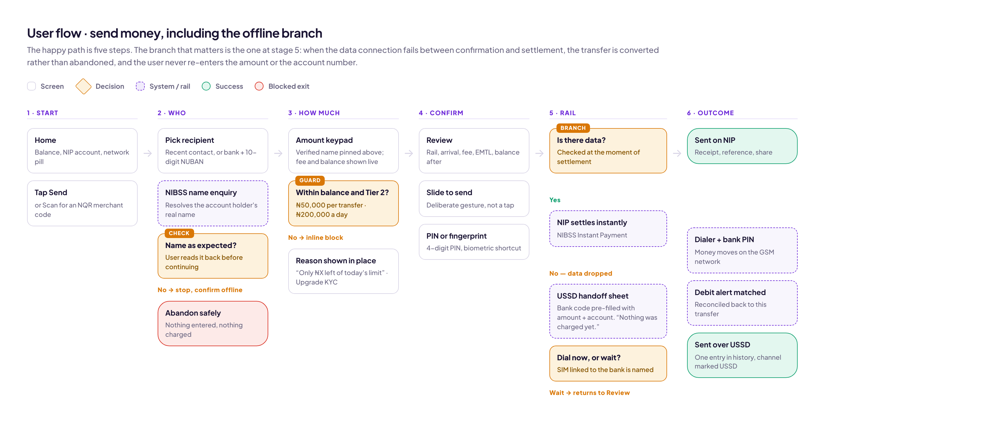

Three control points are deliberately placed where they interrupt least and protect most:

- **Name check** sits immediately after account resolution and before any amount is entered — so abandoning costs the user nothing.
- **Limit guard** is evaluated during amount entry, in place, with the remaining headroom stated. The user is never allowed to complete a flow that compliance will reject at the end of it.
- **Rail branch** is evaluated at settlement, not at screen load, because connectivity in this market changes within the span of a single flow.

---

## 8. Wireframes

### The core flow

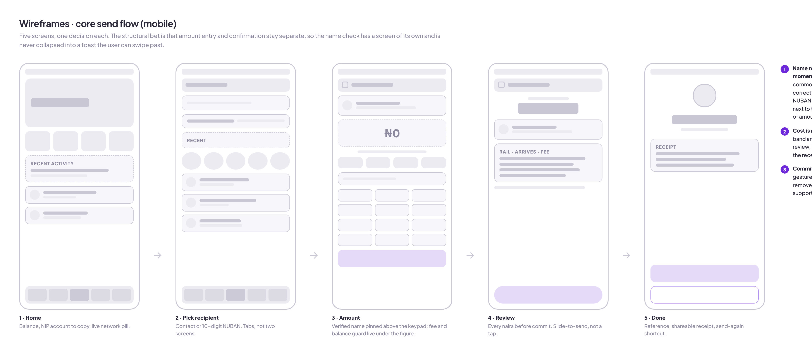

The structural bet is keeping amount entry and confirmation on separate screens. A combined screen tests faster and is what several competitors do. It also collapses the name check into something a user can skim past, which is precisely the error that costs the most money. The extra screen was kept.

### The offline branch

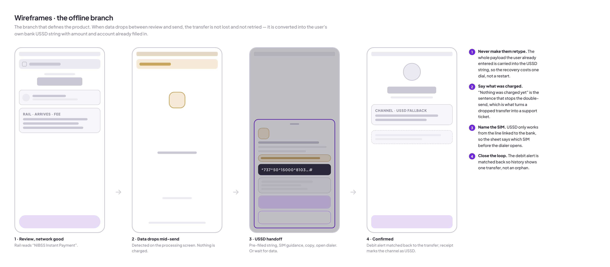

This sequence went through more revisions than the rest of the product combined. Four decisions survived:

1. **Carry the whole payload.** The USSD string is generated with amount and destination account already embedded. Recovery costs one dial, not a restart.
2. **State the charge status in the first sentence.** "Nothing was charged yet" is what stops the double-send. It is the single highest-value sentence in the product.
3. **Name the SIM.** Bank USSD only works from the line registered to that account. A dual-SIM user with data on one line and their bank on the other will otherwise fail silently, so the sheet says which SIM before the dialer opens.
4. **Offer the way out.** "Wait for data instead" returns to review with everything intact. Users who distrust USSD are not trapped.

### Web

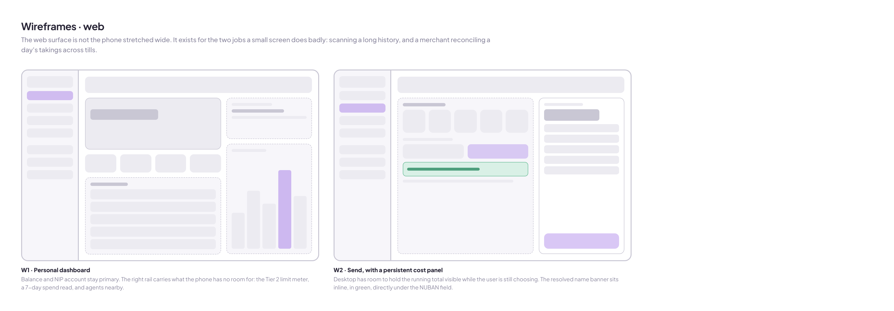

The web surface is not the phone stretched wide. It exists for the two jobs a small screen does badly: scanning a long history, and a merchant reconciling a day's takings across tills.

---

## 9. The design system

Built as tokens first, because the prototype and production code share them.

| Token | Value | Role |
|---|---|---|
| `--brand` | `#3B1D8F` | Primary surfaces, hero gradient base |
| `--brand-2` | `#6D28D9` | Interactive, gradient top |
| `--naira` | `#0E9F6E` | Money in, verified states, free-of-charge |
| `--amber` | `#D97706` | Degraded network, awaiting confirmation |
| `--red` | `#D92D20` | Failure, returned funds, limit breach |
| `--ink` | `#1A1433` | Primary text |

**Typography** is Plus Jakarta Sans throughout, with tabular lining numerals (`font-variant-numeric: tabular-nums`) on every monetary figure. Amounts in a list must align on the decimal or they cannot be compared at a glance — this is the kind of detail that is invisible when right and corrosive when wrong.

**Colour carries one meaning only.** Amber never means "warning" in the generic sense; it means specifically that the network is degraded or a confirmation is outstanding. Green is reserved for money arriving and for verified identity. Neither is ever used decoratively.

**Motion** is purposeful and respects `prefers-reduced-motion`. The slide-to-send gesture, the processing ring and the success burst are the only non-trivial animations, and each marks a state change the user needs to register.

---

## 10. High-fidelity screens — mobile

### Onboarding

| | | |
|---|---|---|
| 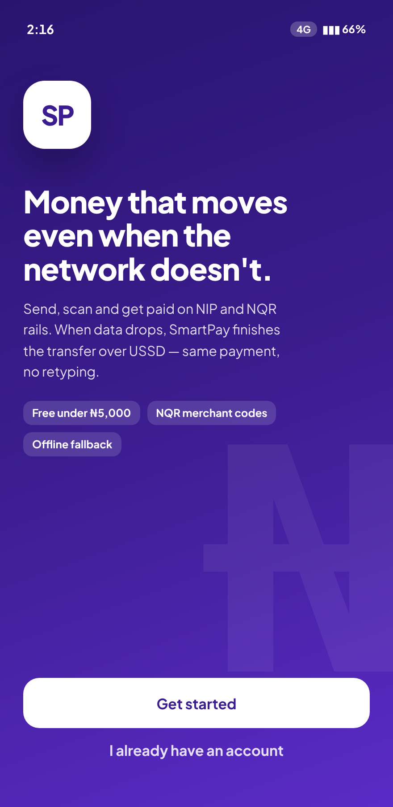 | 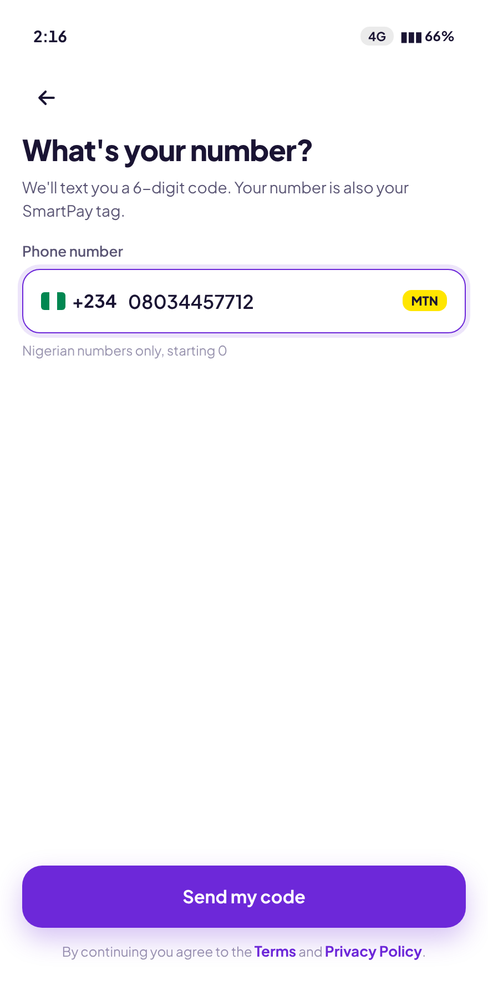 | 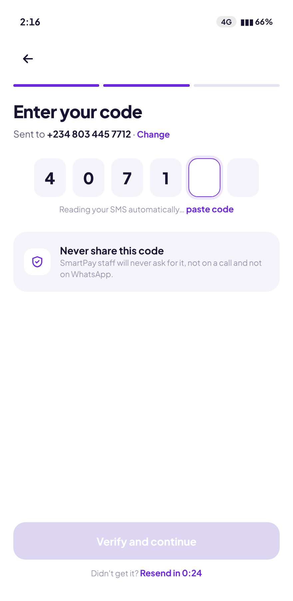 |
| **Welcome** — the proposition is the offline capability, stated in the first line. | **Phone entry** — carrier detected live from the prefix; the number doubles as the SmartPay tag. | **OTP** — auto-reads the SMS; the anti-fraud warning is specific about WhatsApp, which is where the scams actually happen. |

### Home, in both network states

| | |
|---|---|
|  | 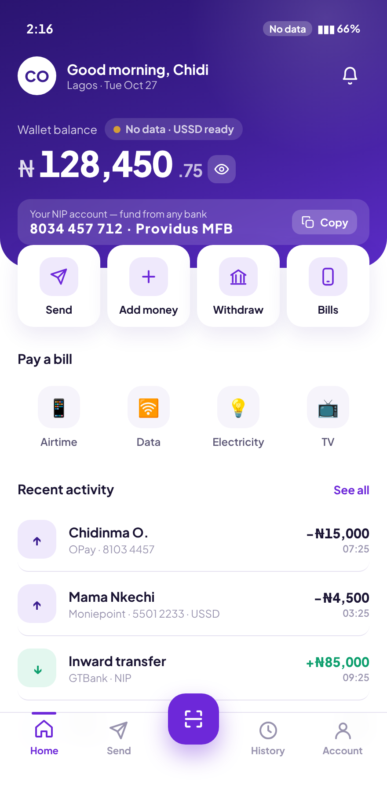 |
| Network good. Balance, NIP virtual account with one-tap copy, quick actions, recent activity. | No data. The same screen, honestly labelled "No data · USSD ready" — a statement of capability, not an apology. |

The NIP virtual account on the home screen is a deliberate inversion. Most wallets bury the fund-in account. Putting it at the top, copyable, says the wallet is reachable from any bank in the country without the user asking how.

### The send flow

| | | |
|---|---|---|
| 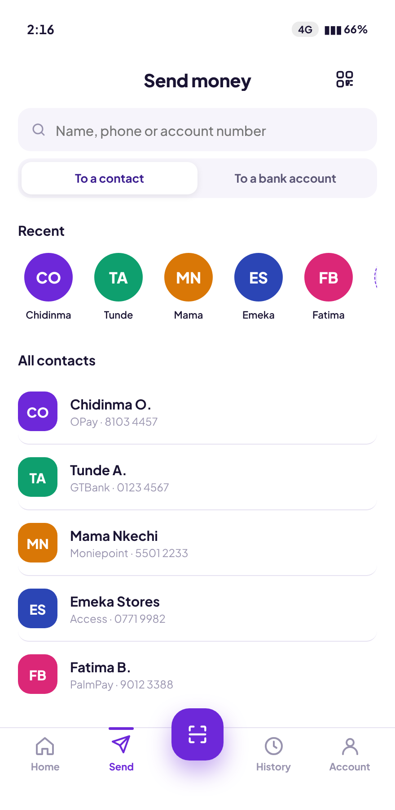 | 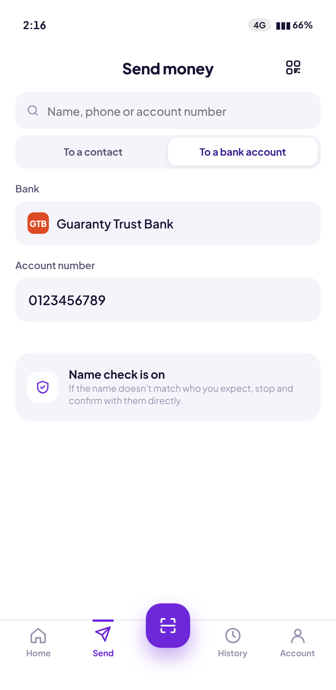 | 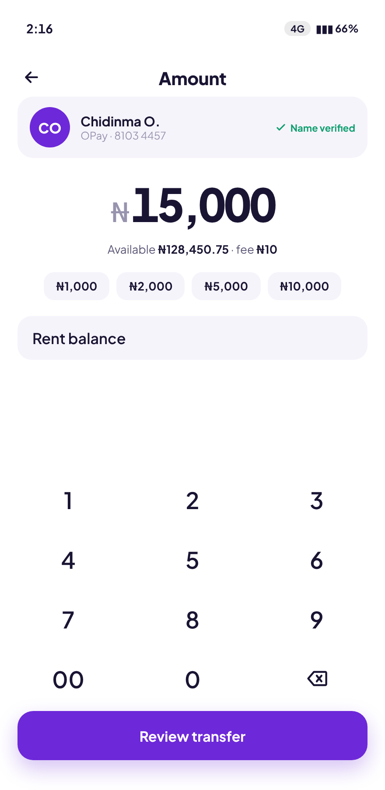 |
| Recent people first. | Bank and 10-digit NUBAN, with the name check explained before it runs. | The verified name stays pinned above the keypad. Fee and balance guard update live. |

| | | |
|---|---|---|
| 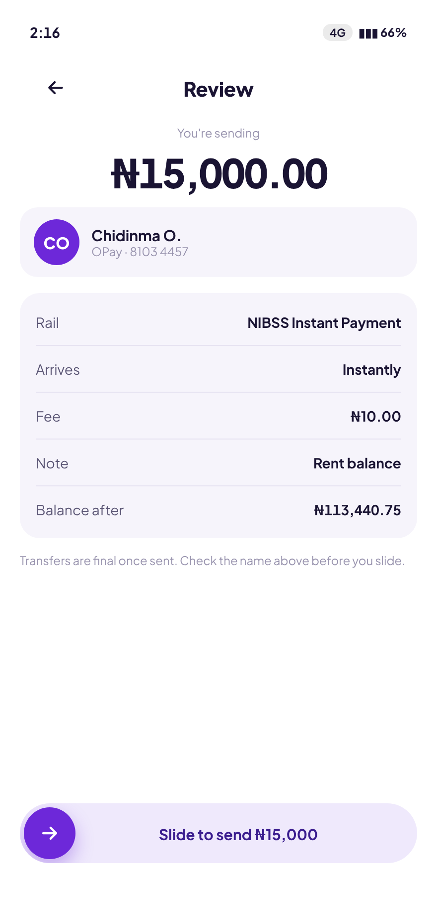 | 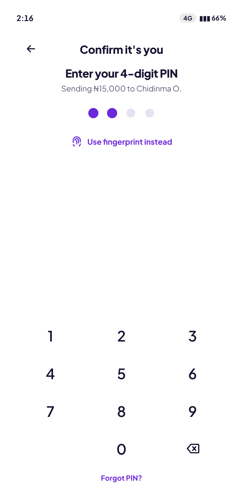 | 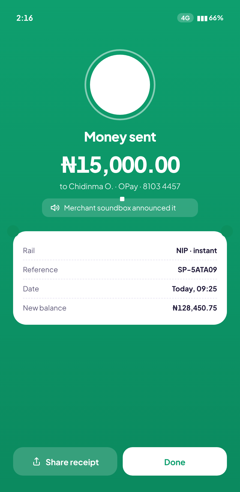 |
| Rail, arrival, fee, note and balance-after, before the slide. | Four-digit PIN with a biometric shortcut. | Reference, shareable receipt, send-again. |

### The offline handoff

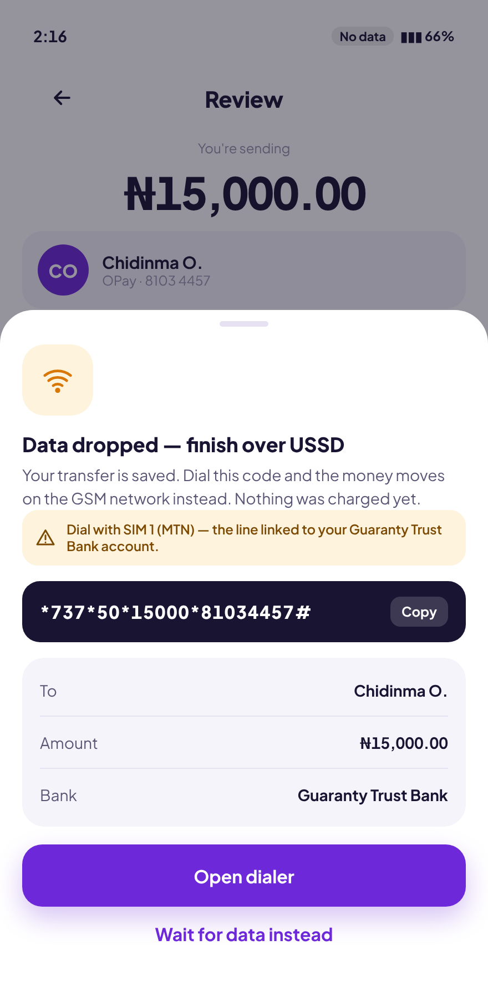

The screen the product exists for. The transfer is saved, the charge status is stated first, the SIM is named, and the bank's USSD string is pre-filled with the amount and the destination account. Copy, or open the dialer. Or wait for data and keep everything.

### Money in, money out, and the cash edge

| | | |
|---|---|---|
| 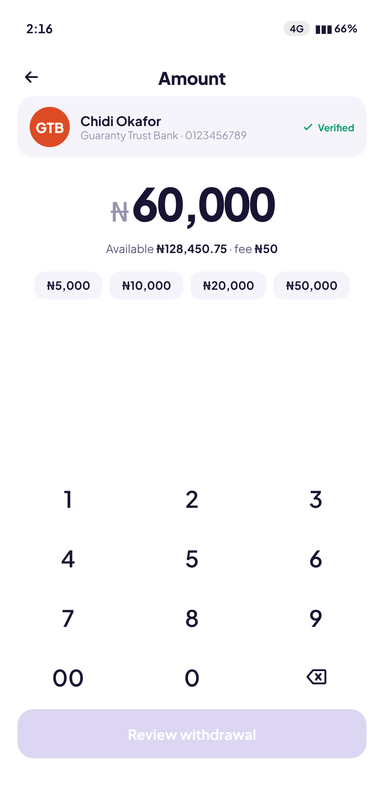 | 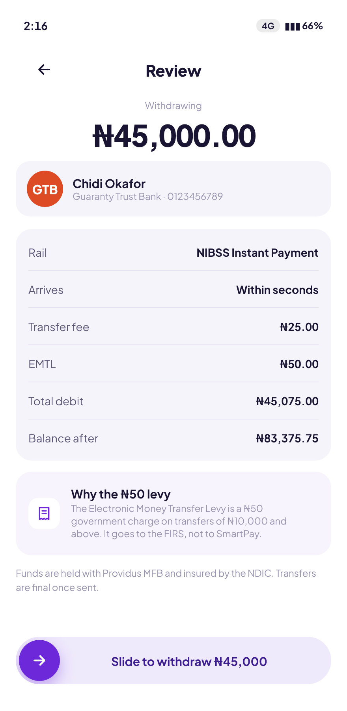 | 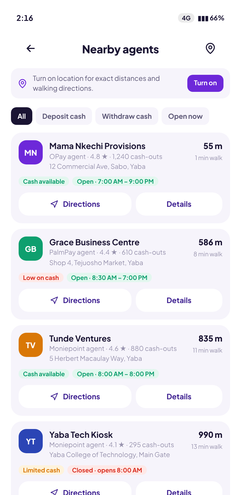 |
| Tier 2 headroom stated as money remaining, not as a blocked button. | NIP fee and the ₦50 EMTL itemised separately before confirmation. | Agent banking with distance, opening hours and cash availability — the cash-out path for users who need notes, not balance. |

### Scan, history and the receipt

| | | |
|---|---|---|
| 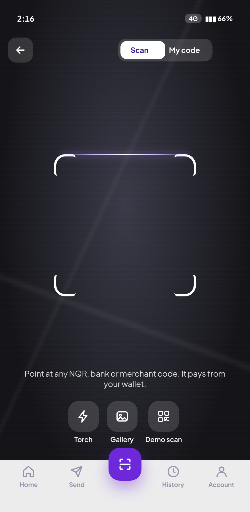 | 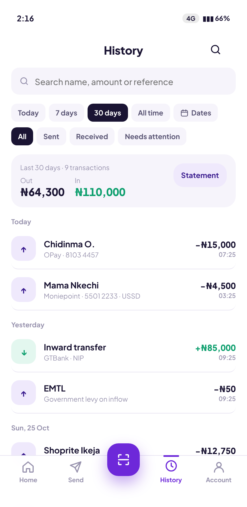 | 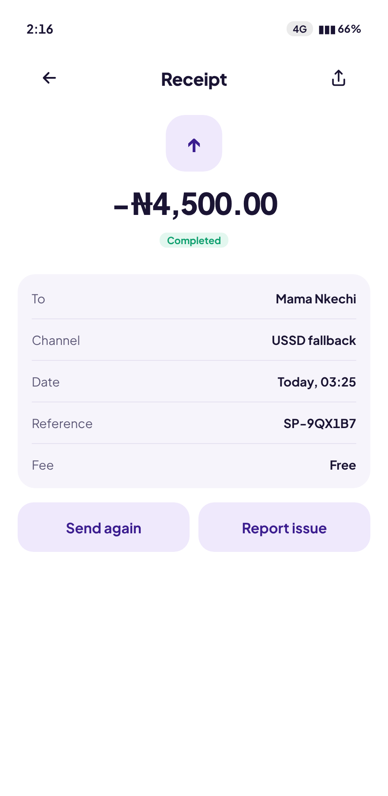 |
| Camera opens immediately — no interstitial permission screen between intent and action. | Date ranges, type filters, in/out totals for the selected range. | Channel is named. A USSD transfer reads as a USSD transfer. |

Two states in history deserve note. A **pending** USSD transfer explains itself in plain language — "Sent over USSD at 7:31 PM. We confirm the moment the debit alert lands." A **failed** transfer states the recovery outright — "₦8,200 was returned to your wallet on 12 Sep. Nothing was lost." Failure messages that do not say where the money went are not failure messages; they are the start of a support ticket.

---

## 11. High-fidelity screens — web

### Personal dashboard

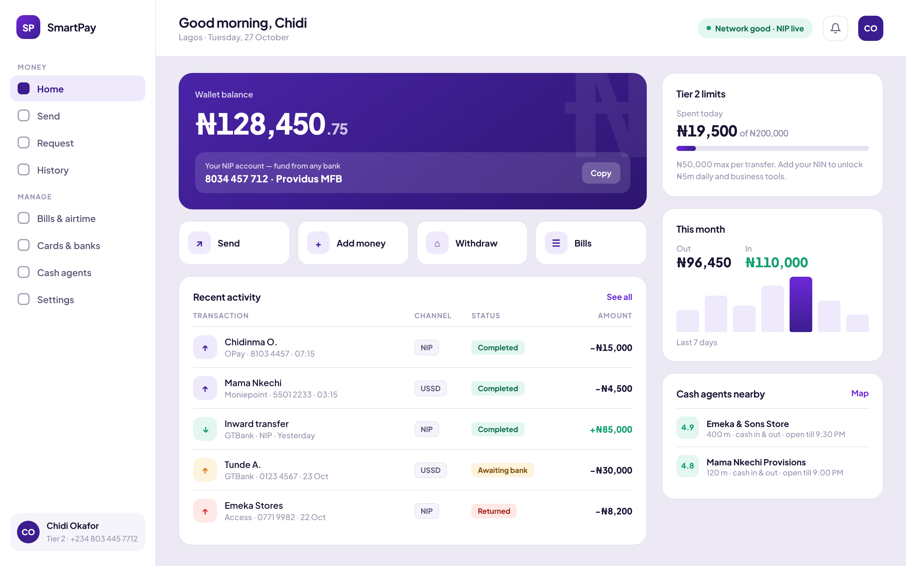

The right rail carries what the phone has no room for: the Tier 2 limit meter as a running total, a seven-day spend read, and nearby agents. The transaction table adds a **channel** column, because on desktop the user is usually reconciling rather than transacting, and "which rail did this go over" is the question being asked.

### Send, with a persistent cost panel

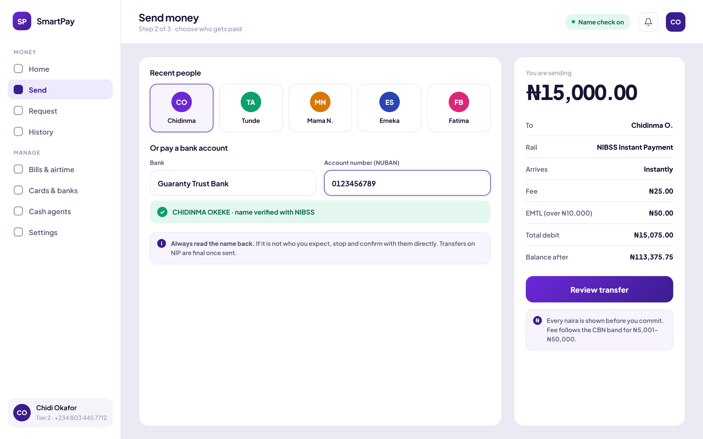

Desktop has the room to keep the running total visible while the user is still choosing a recipient. Fee, EMTL, total debit and balance-after are all on screen before the amount is finalised. The resolved name sits inline and green, directly beneath the NUBAN field.

### Business console

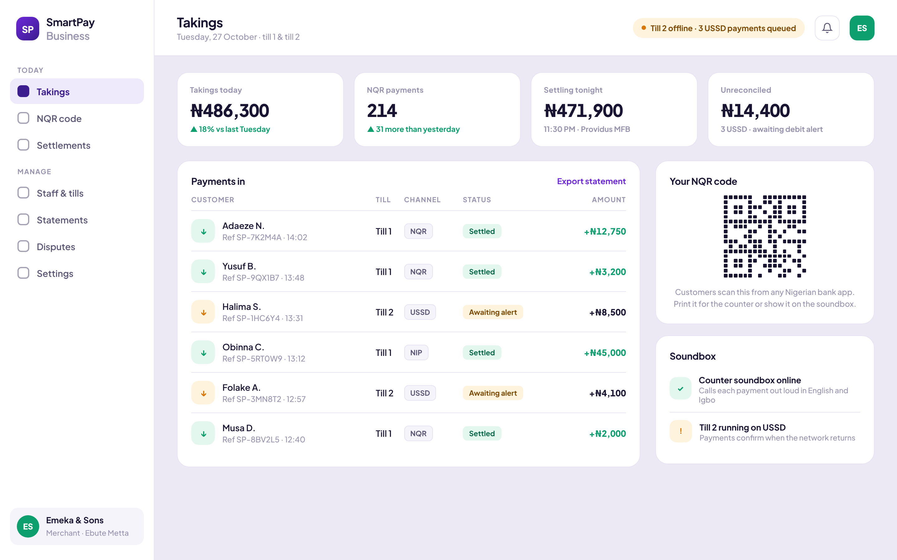

The merchant surface, and the clearest business case in the product. A trader with two tills needs one question answered at close of day: does what the app says match what is in the account? The console answers it by splitting takings by channel, flagging the USSD payments still awaiting a debit alert, and stating the settlement time and destination.

The offline capability that protects a consumer from a failed transfer protects a merchant from a lost sale. That is the same feature sold twice.

---

## 12. Accessibility and inclusive design

- **Touch targets** are 44px minimum throughout; the keypad and the nav bar are larger.
- **Focus is always visible** — a 3px outline with a 2px offset on every interactive element, which matters because a meaningful share of Android users in this market navigate with assistive hardware.
- **Colour is never the only signal.** Money in and money out are distinguished by arrow direction and sign as well as hue. Status chips carry words, not just fills.
- **Reduced motion** is respected globally.
- **Dark mode** follows the system, with a light-mode override available.
- **Offline is an accessibility concern here,** not only a technical one. Designing for an unreliable connection is designing for the users with the cheapest data plans and the oldest devices — which is to say, most of the market.
- **Plain language throughout.** Nigerian English, not banking English. "Needs attention" rather than "exception". "Money was returned" rather than "reversal".

---

## 13. What changed between rounds

The honest part of any case study is what was wrong first.

| Round | What broke | What changed |
|---|---|---|
| 1 | The USSD handoff appeared as a toast. Users dismissed it and lost the transfer. | Promoted to a modal sheet that cannot be swiped away accidentally. |
| 1 | "Transaction pending" produced immediate double-sends. | Rewritten to "Nothing was charged yet", stated before anything else. |
| 2 | Dual-SIM users dialled from the wrong line and the code failed silently. | Added the SIM guidance row naming the line linked to the bank. |
| 2 | Fees were disclosed on the success screen. | Moved to review, itemised, with EMTL named as a government levy. |
| 3 | Users tapped send accidentally while scrolling review. | Replaced the button with slide-to-send. |
| 3 | The limit error was a blocked button with no explanation. | Replaced with the remaining headroom stated in naira, plus the upgrade path. |

---

## 14. Impact

### User impact

| Outcome | Why the design produces it |
|---|---|
| A dropped transfer stops being a lost transfer | The payload is carried into USSD; recovery costs one dial instead of a full re-entry |
| Double-sends fall sharply | The charge status is stated before the user can act on their own uncertainty |
| Cost stops being a surprise | Fee, levy, total and balance-after all appear before the irreversible step |
| Wrong-account transfers become harder to make | Name resolution gets its own moment and stays visible through amount entry |
| Limit rejections stop being dead ends | Headroom is stated in naira with an upgrade path attached |
| The cash edge is reachable | Agent distance, hours and float status are in the app, not a separate search |

### Business impact

| Lever | Mechanism |
|---|---|
| **Completed transaction volume** | Interrupted transfers that previously abandoned now complete on the second rail. Every recovered transfer is recovered revenue. |
| **Support cost** | "Did it go through?" is the highest-volume contact reason in this category. Answering it in the interface deflects the contact entirely. |
| **Chargeback and reversal load** | Fewer double-sends means fewer manual reversals, each of which carries operational cost and regulatory reporting. |
| **Retention** | Reliability under bad network is the differentiator competitors cannot copy without rebuilding their transaction state model. |
| **Merchant acquisition** | The business console turns a consumer reliability feature into a merchant reconciliation product, opening a second revenue line against the same engineering. |
| **Regulatory posture** | Tier limits, EMTL and fee bands modelled explicitly in the interface reduce compliance exposure and shorten audit conversations. |

### The impact model

The figures below are **modelled, not measured**. They are shown with their inputs so the model can be audited, argued with, or replaced wholesale with real data.

**Assumptions**

| Input | Value | Basis |
|---|---|---|
| Monthly active users | 100,000 | Planning cohort |
| Transfers per user per month | 8 | Category benchmark |
| Transfer attempts per month | 800,000 | Derived |
| Attempts hitting degraded or no data at settlement | 11% | **Replace with your telemetry** |
| Interrupted attempts abandoned without the fallback | 68% | **Replace with your telemetry** |
| Interrupted attempts completed in-session with the fallback | 74% | **Replace with your usability data** |
| Support contacts per 1,000 abandoned transfers | 190 | **Replace with your support data** |
| Fully-loaded cost per support contact | ₦850 | **Replace with your finance data** |
| Net contribution per completed transfer | ₦6 | **Replace with your unit economics** |

**Modelled outcomes, per month**

| Measure | Without fallback | With fallback | Delta |
|---|---|---|---|
| Interrupted transfer attempts | 88,000 | 88,000 | — |
| Completed despite interruption | 28,160 | 65,120 | **+36,960** |
| Abandoned | 59,840 | 22,880 | **−36,960** |
| Support contacts from abandoned transfers | 11,370 | 4,347 | **−7,023** |
| Support cost | ₦9.7m | ₦3.7m | **−₦6.0m** |
| Contribution from recovered transfers | — | ₦221,760 | **+₦221,760** |

Read the model, not the total. The support-cost line is where the money is, and it is the line most sensitive to the contact-rate assumption — which is exactly why that assumption should be the first one you replace.

---

## 15. What I would do next

- **Instrument the branch.** The rail decision is the one event worth measuring above all others: how often it fires, how often the user dials, how often the debit alert matches.
- **Validate USSD string generation against every bank**, not the eight modelled here. Code formats vary and a wrong string is worse than no string.
- **Test the SIM guidance with real dual-SIM users.** It is the step most likely to fail quietly in the field.
- **Push reconciliation further.** Matching the debit alert back to the transfer is currently modelled. Making it genuinely reliable is the hardest engineering problem in the product and the one the whole promise rests on.
- **Take the business console to real traders.** It is the strongest commercial idea here and the least validated.

---

## 16. Reflection

The brief said faster. The work said certain.

The most valuable thing in this product is not a feature in the usual sense — it is a refusal to treat a lost connection as the end of a transaction. Everything else follows from that: the plain-language charge status, the pre-filled USSD string, the channel column in history, the merchant console that reconciles across rails.

The lesson I would carry forward is that in markets with unreliable infrastructure, the interesting design problems are rarely in the happy path. They are in what the product does at the exact moment it stops working. Most teams spend their design effort on the 89% of transactions that succeed. The 11% is where the trust is won or lost.

---

## Appendix — screen inventory

Onboarding: `welcome`, `login`, `otp`
Core: `home`, `send`, `amount`, `review`, `pin`, `processing`, `success`
Payments: `scan`, `receive`, `bills`
Money in: `topup`, `topupamount`, `fundbank`, `addcard`, `cards`
Money out: `withdraw`, `withdrawamount`, `withdrawreview`, `agents`
Records: `history`, `txdetail`
Account: `account`, `profile`, `security`, `notifications`, `help`

Twenty-nine screens, all built and interactive in the prototype in this repository.

---

*Prototype, flows and screens in this case study are captured from the working build in this repository. Research findings and impact figures are a stated model — replace them with your own data before publishing.*
